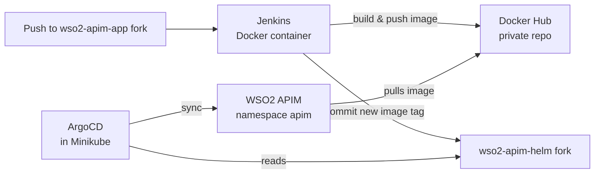
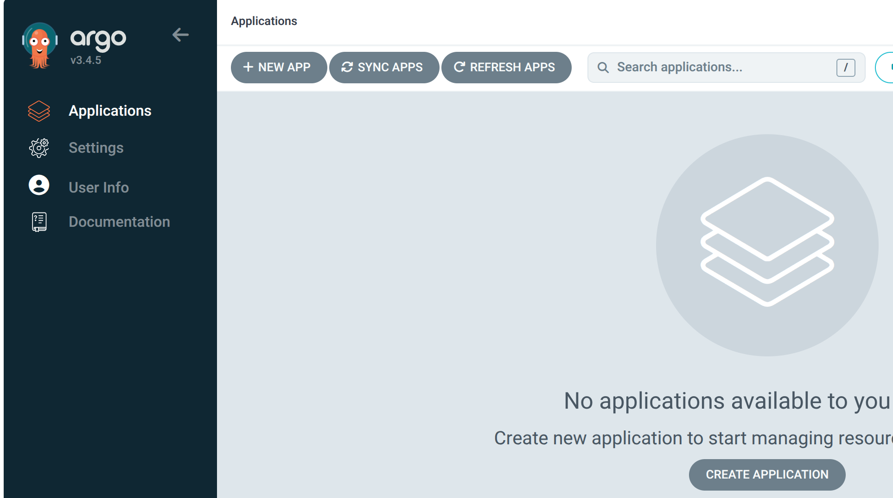
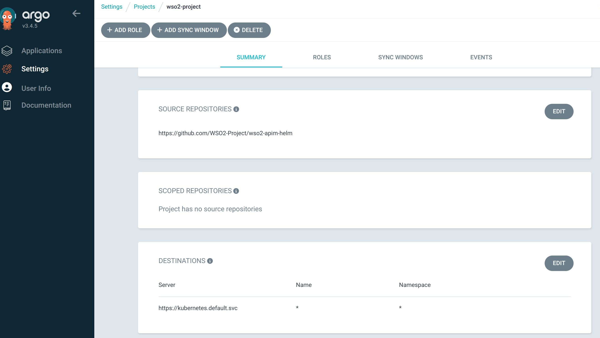
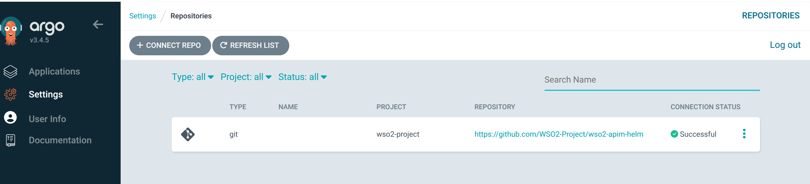
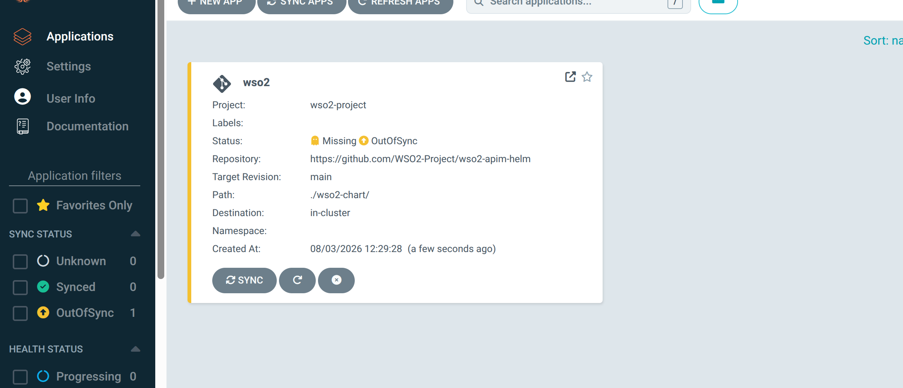
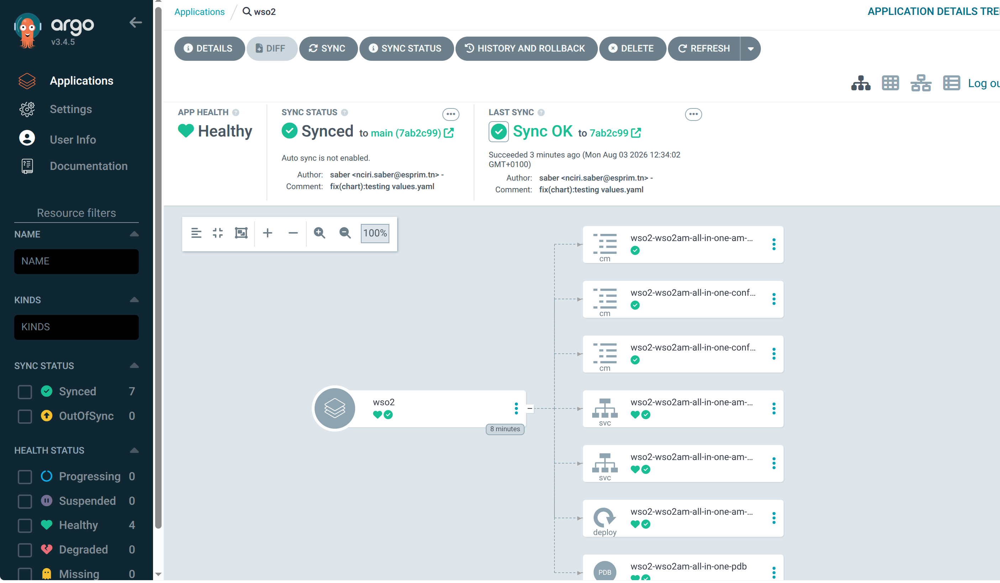

# deployment-docs

**Step-by-step guide to deploying the apim-gitops system on a local Minikube cluster from your own forks.**

By the end of this guide you will have:

- A Minikube cluster running WSO2 API Manager 4.7.0, exposed through Envoy Gateway
- ArgoCD syncing the Helm chart from **your** fork of `wso2-apim-helm`
- Jenkins building **your** custom image, pushing it to **your** Docker Hub repository, and bumping the image tag in **your** Helm fork

> **Scope:** single-node, local deployment on Minikube with the Docker driver. Other Kubernetes distributions may need changes, mostly in networking (Gateway address, tunnel, DNS).
> **Out of scope:** high availability, multi-node clusters, Jenkins agents, production hardening.

---

## Table of Contents

1. [How it fits together](#1-how-it-fits-together)
2. [Prerequisites](#2-prerequisites)
3. [Fork and configure the repositories](#3-fork-and-configure-the-repositories)
4. [Create the GitHub Apps](#4-create-the-github-apps)
5. [Start Minikube](#5-start-minikube)
6. [Install Envoy Gateway](#6-install-envoy-gateway)
7. [Install ArgoCD and expose it](#7-install-argocd-and-expose-it)
8. [Configure DNS and start the tunnel](#8-configure-dns-and-start-the-tunnel)
9. [Connect ArgoCD to your Helm fork](#9-connect-argocd-to-your-helm-fork)
10. [Deploy Jenkins](#10-deploy-jenkins)
11. [Configure Jenkins](#11-configure-jenkins)
12. [Verify end to end](#12-verify-end-to-end)
13. [Troubleshooting](#13-troubleshooting)
14. [Cleanup](#14-cleanup)

---

## 1. How it fits together



| Component | Where it runs | Talks to GitHub with |
|---|---|---|
| Jenkins | Docker container on your host (outside the cluster) | GitHub App **#1** (read/write) |
| ArgoCD | Minikube, namespace `argocd` | GitHub App **#2** (read-only) |
| Envoy Gateway | Minikube, namespace `envoy-gateway-system` | n/a |
| WSO2 APIM | Minikube, namespace `apim` | n/a |

For the full architecture, see the [organization README](https://github.com/apim-gitops).

---

## 2. Prerequisites

### Tools

| Tool | Notes |
|---|---|
| [Docker](https://docs.docker.com/get-docker/) | Runs Minikube (Docker driver) and Jenkins |
| [Minikube](https://minikube.sigs.k8s.io/docs/start/) | Local Kubernetes cluster |
| [kubectl](https://kubernetes.io/docs/tasks/tools/) | Cluster CLI |
| [Helm 3](https://helm.sh/docs/intro/install/) | Installs Envoy Gateway and ArgoCD |
| `git`, `openssl` | Forking/cloning and converting the GitHub App key for Jenkins |

### Accounts

- A **GitHub account** (personal or organization) to host your forks and GitHub Apps
- A **Docker Hub account** with:
  - a **private repository** for the custom image (e.g. `YOUR_DOCKERHUB_USER/wso2-apim`)
  - a **Personal Access Token** with *Read & Write* scope ([Account Settings → Personal access tokens](https://app.docker.com/settings/personal-access-tokens))

### Resources (recommended)

WSO2 API Manager is resource-intensive. With Minikube's defaults the pods tend to crash or stay `Pending`.

| Resource | Recommended for Minikube |
|---|---|
| Memory | 8 GB |
| CPUs | 4 |

Your host needs more than that, because Jenkins also runs on it. If you use Docker Desktop, raise its memory limit above 8 GB first.

### Placeholders used in this guide

| Placeholder | Replace with |
|---|---|
| `YOUR_GITHUB_USER` | The GitHub user or organization that owns your forks |
| `YOUR_DOCKERHUB_USER` | Your Docker Hub username |
| `<GATEWAY_ADDRESS>` | The IP shown by `kubectl get gateway -n apim` (see [step 6](#6-install-envoy-gateway)) |

---

## 3. Fork and configure the repositories

You cannot push to the original repositories, and every pipeline writes back to Git. **Fork all three repositories** under `YOUR_GITHUB_USER`:

| Repository | Why you need a fork |
|---|---|
| [`wso2-apim-app`](https://github.com/WSO2-Project/wso2-apim-app) | Jenkins builds it and pushes release branches and tags |
| [`wso2-apim-helm`](https://github.com/WSO2-Project/wso2-apim-helm) | Jenkins commits the new image tag; ArgoCD reads it |
| [`ci-app-pipelines`](https://github.com/WSO2-Project/ci-app-pipelines) | Gitflow pipelines run from it and target your app fork |

When forking, **uncheck "Copy the `main` branch only"**. The Gitflow model relies on `develop`.

Clone your forks and this repository (you need its `manifests/` folder):

```bash
git clone https://github.com/YOUR_GITHUB_USER/wso2-apim-app.git
git clone https://github.com/YOUR_GITHUB_USER/wso2-apim-helm.git
git clone https://github.com/YOUR_GITHUB_USER/ci-app-pipelines.git
git clone https://github.com/apim-gitops/deployment-docs.git
```

### 3.1 Replace references to the original organization

Each fork may still point at `WSO2-Project`. List the occurrences in every fork:

```bash
grep -rn "WSO2-Project" wso2-apim-app wso2-apim-helm ci-app-pipelines
```

Replace each one with `YOUR_GITHUB_USER`, except in links that intentionally point to the original documentation.

### 3.2 `wso2-apim-app`: set your image name

In the `Jenkinsfile`, replace the placeholder with your Docker Hub repository:

```groovy
IMAGE_NAME = 'YOUR_DOCKERHUB_USER/wso2-apim'   // was 'changeme'
```

The pipeline builds and pushes this image. It must match the `repository` value in the Helm chart (next step).

### 3.3 `wso2-apim-helm`: point the chart at your private image

In `wso2-chart/values.yaml`, edit the `deployment.image` block:

```yaml
deployment:
  image:
    imagePullSecrets:
      enabled: true
      name: "dockerhub-pull-secret"   # created with kubectl in step 9.1
    registry: "docker.io"
    repository: "YOUR_DOCKERHUB_USER/wso2-apim"   # must match IMAGE_NAME
    tag: 4.7.0_0.4.0-SNAPSHOT-b09ca567a           # managed by Jenkins, do not edit
```

- **`imagePullSecrets`:** the image is private, so the cluster needs credentials to pull it. Referencing an existing Secret by `name` keeps your Docker Hub PAT **out of Git**. The chart also accepts `username`/`password` inline, but avoid that in any repository others can read.
- **`tag`:** Jenkins rewrites this line on every build (`sed -i 's|tag:.*|tag: <IMAGE_TAG>|' wso2-chart/values.yaml`). Leave it as is. ArgoCD will fail to pull the current value until Jenkins has pushed your first image (see [step 12](#12-verify-end-to-end)).

Commit and push these changes to `main` in each fork.

**✅ Checkpoint:** three forks under `YOUR_GITHUB_USER` with no remaining `WSO2-Project` references, `IMAGE_NAME` set, and `values.yaml` pointing at your Docker Hub repository.

---

## 4. Create the GitHub Apps

Two apps, following least privilege:

| App | Used by | Access | Installed on |
|---|---|---|---|
| `apim-gitops-jenkins` | Jenkins (credential `github-credentials`) | Read/write | `wso2-apim-app`, `ci-app-pipelines`, `wso2-apim-helm` |
| `apim-gitops-argocd` | ArgoCD | Read-only | `wso2-apim-helm` |

> App names must be globally unique on GitHub. Add a suffix if a name is taken.

### 4.1 Create an app

Repeat this for each app, using the permissions in 4.2.

1. Go to **Settings → Developer settings → GitHub Apps → New GitHub App**. For an organization, use **Organization settings → Developer settings**.
2. Fill in:
   - **GitHub App name:** e.g. `apim-gitops-jenkins`
   - **Homepage URL:** any URL, such as your fork URL
   - **Webhook:** uncheck **Active**. Jenkins runs on localhost and polls instead (see [11.4](#114-a-note-on-triggers)).
   - **Where can this GitHub App be installed?** *Only on this account*
3. Set the **Repository permissions** from 4.2, then click **Create GitHub App**.
4. On the app page, note the **App ID**.
5. Under **Private keys**, click **Generate a private key**. A `.pem` file downloads. Store it safely; GitHub will not show it again.

### 4.2 Permissions

| Repository permission | `apim-gitops-jenkins` | `apim-gitops-argocd` |
|---|---|---|
| Metadata | Read-only (mandatory) | Read-only (mandatory) |
| Contents | **Read and write** (push commits, branches, tags; delete branches) | Read-only |
| Checks | Read and write (GitHub Checks plugin) | none |
| Commit statuses | Read and write | none |
| Pull requests | Read-only (multibranch PR discovery) | none |

> If you enable **branch protection** on `main` or `develop` in your forks, add `apim-gitops-jenkins` to the bypass list. Otherwise the release pipelines cannot push merges and tags.

### 4.3 Install each app

1. On the app page, click **Install App**, then select your account.
2. Choose **Only select repositories** and pick the repositories from the table at the top of this section.
3. After installing, the browser URL looks like `https://github.com/settings/installations/12345678`. That number is the **Installation ID**. Note it.

### 4.4 Convert the Jenkins key to PKCS#8

Jenkins only accepts GitHub App keys in PKCS#8 format. ArgoCD accepts the original file.

```bash
openssl pkcs8 -topk8 -inform PEM -outform PEM -nocrypt \
  -in apim-gitops-jenkins.<date>.private-key.pem \
  -out apim-gitops-jenkins-pkcs8.pem
```

**✅ Checkpoint:** for each app you have an **App ID**, an **Installation ID**, and a private key (PKCS#8 for Jenkins).

---

## 5. Start Minikube

```bash
minikube start \
  --profile=minikube \
  --driver=docker \
  --memory=8192 \
  --cpus=4
```

Minikube's default memory cap is too low for WSO2. Memory and CPU settings only apply when a cluster is **created**. If you already have a `minikube` profile, run `minikube delete` first.

**✅ Checkpoint:**

```bash
kubectl get nodes
# NAME       STATUS   ROLES           AGE   VERSION
# minikube   Ready    control-plane   ...   ...
```

---

## 6. Install Envoy Gateway

This follows the [official WSO2 all-in-one Kubernetes guide](https://apim.docs.wso2.com/en/latest/install-and-setup/setup/kubernetes-deployment/kubernetes/am-pattern-0-all-in-one/). The one difference: our Gateway adds an extra listener for ArgoCD.

```bash
helm install envoy-gateway oci://docker.io/envoyproxy/gateway-helm \
  --version v1.7.0 \
  --namespace envoy-gateway-system \
  --create-namespace \
  --set config.envoyGateway.extensionApis.enableBackend=true \
  --set envoyGateway.gateway.experimentalFeatures.enabled=true
```

Create the namespace for WSO2 and apply the custom Gateway (from the `deployment-docs` clone):

```bash
kubectl create namespace apim
kubectl apply -f deployment-docs/manifests/custom-gateway.yml
```

> **Why is the Gateway not in the Helm chart?** ArgoCD itself is reached through this Gateway. If the Gateway were deployed by ArgoCD, you could not open ArgoCD before the first sync. So the Gateway is applied manually, before ArgoCD.

**✅ Checkpoint:**

```bash
kubectl get gateway -n apim
```

```
NAME                CLASS           ADDRESS         PROGRAMMED   AGE
wso2-apim-gateway   envoy-gateway   10.107.31.162   True         2m20s
```

`PROGRAMMED` must be `True`. **Note the value in the `ADDRESS` column.** This is your `<GATEWAY_ADDRESS>`, and it will most likely differ from the example above. If `ADDRESS` is empty, start the tunnel ([step 8](#8-configure-dns-and-start-the-tunnel)) and check again.

---

## 7. Install ArgoCD and expose it

```bash
helm repo add argo https://argoproj.github.io/argo-helm
helm repo update

helm install argocd argo/argo-cd \
  --namespace argocd \
  --create-namespace \
  --set configs.params."server\.insecure"=true
```

- **`server.insecure=true`** makes the ArgoCD server serve plain HTTP inside the cluster. TLS is handled at the Gateway, so without this flag ArgoCD redirects to HTTPS itself and the route loops.
- Replicas are left at 1, consistent with the non-HA scope, to save memory for WSO2.

Expose ArgoCD through the Gateway:

```bash
kubectl apply -f deployment-docs/manifests/custom-httproute.yml
```

**✅ Checkpoint:**

```bash
kubectl get pods -n argocd      # all Running
kubectl get httproute -A        # the ArgoCD route is listed
```

---

## 8. Configure DNS and start the tunnel

### 8.1 Hosts file

Map the WSO2 and ArgoCD hostnames to your `<GATEWAY_ADDRESS>` from [step 6](#6-install-envoy-gateway). Add this line to `/etc/hosts` (requires `sudo`):

```text
<GATEWAY_ADDRESS> am.wso2.com gw.wso2.com websocket.wso2.com websub.wso2.com argocd.wso2.com
```

> On macOS the file is also `/etc/hosts`. On Windows it is `C:\Windows\System32\drivers\etc\hosts`, edited as Administrator. These two platforms have not been tested with this setup.

### 8.2 Tunnel

In a **separate terminal that you keep open**:

```bash
minikube tunnel
```

The tunnel adds a route from your host to the cluster's service network, which is what makes `<GATEWAY_ADDRESS>` reachable. It may prompt for your `sudo` password. If you close this terminal, the hostnames stop resolving to anything reachable.

**✅ Checkpoint:** `https://argocd.wso2.com` loads the ArgoCD login page. Accept the self-signed certificate warning. `am.wso2.com` will only answer after WSO2 is deployed in step 9.

---

## 9. Connect ArgoCD to your Helm fork

ArgoCD deploys WSO2 instead of a manual `helm install`. This guide uses the ArgoCD UI, which is easier the first time. The declarative equivalent is shown in [9.5](#95-create-the-application).

### 9.1 Create the image pull secret

The WSO2 image is private, so the cluster needs your Docker Hub credentials. The name must match `imagePullSecrets.name` in `values.yaml`.

```bash
kubectl create secret docker-registry dockerhub-pull-secret \
  --namespace apim \
  --docker-server=https://index.docker.io/v1/ \
  --docker-username=YOUR_DOCKERHUB_USER \
  --docker-password=<YOUR_DOCKERHUB_PAT>
```

### 9.2 Log in

Retrieve the initial admin password:

```bash
kubectl -n argocd get secret argocd-initial-admin-secret \
  -o jsonpath="{.data.password}" | base64 -d; echo
```

Open `https://argocd.wso2.com` and log in with username `admin` and that password.



> Change the admin password afterwards: **User Info → Update Password**.

### 9.3 Create a project

**Settings → Projects → + New Project**

- **Project name:** `wso2-project`
- **Source repositories:** `https://github.com/YOUR_GITHUB_USER/wso2-apim-helm`
- **Destinations:** server `https://kubernetes.default.svc`, name `*`, namespace `*`

The project restricts which repository can be deployed and where. The application created in 9.5 must belong to it.



### 9.4 Connect the repository

**Settings → Repositories → + Connect Repo**

- **Connection method:** *via GitHub App*
- **Type:** GitHub
- **Project:** `wso2-project`
- **Repository URL:** `https://github.com/YOUR_GITHUB_USER/wso2-apim-helm`
- **GitHub App ID / Installation ID:** from `apim-gitops-argocd` ([step 4](#4-create-the-github-apps))
- **GitHub App private key:** contents of the `apim-gitops-argocd` `.pem` file

Click **Connect**. The connection status must be **Successful**.



### 9.5 Create the application

**Applications → + New App → Edit as YAML**, then paste:

```yaml
apiVersion: argoproj.io/v1alpha1
kind: Application
metadata:
  name: wso2
spec:
  project: wso2-project
  source:
    repoURL: https://github.com/YOUR_GITHUB_USER/wso2-apim-helm
    targetRevision: main          # branch Jenkins pushes the tag bump to
    path: wso2-chart              # folder containing Chart.yaml
    helm:
      valueFiles:
        - values.yaml
  destination:
    server: https://kubernetes.default.svc
    namespace: apim               # namespace the manifests are deployed into
```

Click **Save**, then **Create**. The application appears as **OutOfSync**.



> Prefer manifests? Save the YAML above as a file and run `kubectl apply -n argocd -f <file>`.

### 9.6 Sync

Click **Sync → Synchronize**. ArgoCD renders the chart and applies it to the `apim` namespace.

Sync is **manual** in this setup, so every change in the Helm fork waits for you to click **Sync**. For automatic sync, add this under `spec:`:

```yaml
  syncPolicy:
    automated:
      prune: true
      selfHeal: true
```

**✅ Checkpoint:**



```bash
kubectl get pods -n apim
```

Until Jenkins pushes your first image, the WSO2 pod shows `ImagePullBackOff`. That is expected, because the tag in `values.yaml` refers to an image that does not exist in **your** Docker Hub repository yet. Everything else (Gateway, routes, services) should be in place. Once your image exists ([step 12](#12-verify-end-to-end)), the pod starts and `https://am.wso2.com/publisher` becomes reachable.

---

## 10. Deploy Jenkins

Jenkins runs in a Docker container **outside** the cluster. Building images requires access to a Docker daemon, which a stock Jenkins container does not have. Rather than mounting the host's Docker socket into Jenkins, this setup puts a [socket proxy](https://github.com/Tecnativa/docker-socket-proxy) in front of it. The proxy only exposes the API endpoints the builds need.

Create a dedicated network so the two containers can reach each other by name:

```bash
docker network create jenkins
```

Start the Docker socket proxy:

```bash
docker run -d \
  --name docker-proxy \
  --restart unless-stopped \
  --network jenkins \
  -v /var/run/docker.sock:/var/run/docker.sock \
  -e CONTAINERS=1 \
  -e POST=1 \
  -e BUILD=1 \
  -e IMAGES=1 \
  -e AUTH=1 \
  tecnativa/docker-socket-proxy
```

The proxy is not published on the host. Only containers on the `jenkins` network can reach it.

Start Jenkins:

```bash
docker run -d \
  --name jenkins-master \
  --restart unless-stopped \
  --network jenkins \
  -p 9000:8080 \
  -p 50000:50000 \
  -v jenkins-data:/var/jenkins_home \
  -e DOCKER_HOST=tcp://docker-proxy:2375 \
  jenkins/jenkins:lts-jdk21
```

Builds run on the controller. Agents are out of scope.

**✅ Checkpoint:** `http://localhost:9000` shows the *Unlock Jenkins* page.

---

## 11. Configure Jenkins

### 11.1 Initial setup

1. Get the initial admin password:
   ```bash
   docker exec jenkins-master cat /var/jenkins_home/secrets/initialAdminPassword
   ```
2. Paste it on the unlock page, choose **Install suggested plugins**, then create your admin user.
3. Go to **Manage Jenkins → Plugins → Available plugins** and install:
   - **GitHub**
   - **GitHub Checks**
   - **Docker Pipeline**

   Restart Jenkins when prompted.

### 11.2 Credentials

**Manage Jenkins → Credentials → System → Global credentials → + Add Credentials**

| ID | Kind | Values |
|---|---|---|
| `github-credentials` | **GitHub App** | App ID of `apim-gitops-jenkins`; key = contents of the **PKCS#8** file from [4.4](#44-convert-the-jenkins-key-to-pkcs8) |
| `dockerhub-credentials` | **Username with password** | Username: `YOUR_DOCKERHUB_USER`; Password: your Docker Hub PAT |

For `github-credentials`, open **Advanced**:

- **Repository access strategy:** *Specify accessible repositories*
- **Owner:** `YOUR_GITHUB_USER`
- **Repositories:** one per line:
  ```text
  wso2-apim-app
  ci-app-pipelines
  wso2-apim-helm
  ```
- **Default permissions strategy:** *All permissions available to the app installation*

`wso2-apim-helm` is required because the build pipeline pushes the image tag bump there.

Click **Test Connection** to confirm the app authenticates. The IDs must match exactly; the Jenkinsfiles reference them by name.

### 11.3 Jobs

#### Build pipeline: `wso2-apim-app` (Multibranch)

**New Item → Multibranch Pipeline**, named `wso2-apim-app`.

- **Branch Sources → Add source → GitHub**
  - **Credentials:** `github-credentials`
  - **Repository HTTPS URL:** `https://github.com/YOUR_GITHUB_USER/wso2-apim-app`
  - Click **Validate**
- **Build Configuration:** by Jenkinsfile, script path `Jenkinsfile`
- **Scan Multibranch Pipeline Triggers:** check *Periodically if not otherwise run*, interval `1 minute` (see [11.4](#114-a-note-on-triggers))

Save. Jenkins scans the repository and creates one job per branch.

#### Gitflow pipelines: `ci-app-pipelines`

Create one **Pipeline** job per Jenkinsfile in `ci-app-pipelines`. For each job:

- **Pipeline → Definition:** *Pipeline script from SCM*
- **SCM:** Git
  - **Repository URL:** `https://github.com/YOUR_GITHUB_USER/ci-app-pipelines`
  - **Credentials:** `github-credentials`
  - **Branch:** `*/main`
- **Script Path:** the pipeline's Jenkinsfile

| Pipeline | Script Path |
|---|---|
| Release | `Jenkinsfile.release` |
| Production | `Jenkinsfile.production` |
| Hotfix | `Jenkinsfile.hotfix` |

See the [`ci-app-pipelines` README](https://github.com/apim-gitops/ci-app-pipelines#setup) for the recommended job names and the parameters each pipeline expects.

### 11.4 A note on triggers

Jenkins runs on `localhost:9000`, which GitHub cannot reach. So this setup **polls**: the multibranch job rescans the repository every minute, which adds a short delay between a push and a build.

For push-triggered builds instead, Jenkins must be reachable from the internet through a public domain or a tunnelling service. You would then enable the webhook on `apim-gitops-jenkins` pointing to `https://<your-domain>/github-webhook/`, and add the *Repository contents* event. This is out of scope here.

**✅ Checkpoint:** the multibranch job lists your branches, and each Gitflow job loads its Jenkinsfile without credential errors.

---

## 12. Verify end to end

1. **Trigger a build.** Push a commit to `develop` in your `wso2-apim-app` fork:
   ```bash
   cd wso2-apim-app
   git checkout develop
   git commit --allow-empty -m "chore: trigger first build"
   git push
   ```
2. **Jenkins** picks it up within about a minute. The build should:
   - build the image and push `YOUR_DOCKERHUB_USER/wso2-apim:<IMAGE_TAG>` to Docker Hub
   - commit `tag: <IMAGE_TAG>` to `wso2-chart/values.yaml` in your `wso2-apim-helm` fork
3. **Docker Hub:** the new tag appears in your private repository.
4. **ArgoCD** detects the commit within about 3 minutes, or immediately if you click **Refresh**. The `wso2` app becomes **OutOfSync**. Click **Sync**.
5. **Cluster:** the WSO2 pod rolls out with the new image:
   ```bash
   kubectl get pods -n apim
   kubectl get deploy -n apim -o jsonpath='{..image}'; echo
   ```
   The image tag matches `<IMAGE_TAG>`. WSO2 takes several minutes to become `Ready`.
6. **WSO2:** open `https://am.wso2.com/publisher` and `https://am.wso2.com/devportal`. The default credentials are `admin` / `admin`.

Which branches publish images and bump the Helm tag is described in the [organization README, Deployment pipeline](https://github.com/apim-gitops#5-deployment-pipeline). To cut a release, see [How to release](https://github.com/apim-gitops#7-how-to-release).

**✅ Final checkpoint:** a push to your app fork ends with a new WSO2 version running in Minikube after one click on **Sync**.

---

## 13. Troubleshooting

Entries marked *(observed)* happened during the original setup. The others are anticipated failure modes.

| Symptom | Likely cause | Fix |
|---|---|---|
| 404 on `am.wso2.com` *(observed)* | Values file disables HTTPRoutes (e.g. an Ingress-based values file) | Make sure ArgoCD uses `wso2-chart/values.yaml` from your fork, with HTTPRoutes enabled |
| Backend services unreachable through the Gateway *(observed)* | Wrong backend configuration in the chart's TOML config | Use the up-to-date chart from `wso2-apim-helm` (`main`); see its README |
| WSO2 pod in `ImagePullBackOff` | No image pushed yet, `repository` ≠ `IMAGE_NAME`, or missing/wrong pull secret | Run the first build ([step 12](#12-verify-end-to-end)); compare the two values; check that `kubectl get secret dockerhub-pull-secret -n apim` exists |
| WSO2 pod `Pending`, `OOMKilled`, or restarting | Not enough memory | Recreate Minikube with `--memory=8192 --cpus=4` ([step 5](#5-start-minikube)) |
| Gateway `ADDRESS` empty | No tunnel running | Run `minikube tunnel` and check again |
| Hostnames do not load | Tunnel closed, or hosts entry does not match the current `ADDRESS` | Keep `minikube tunnel` running; re-run `kubectl get gateway -n apim` and update `/etc/hosts` |
| ArgoCD redirect loop | `server.insecure` not set | `helm upgrade argocd argo/argo-cd -n argocd --reuse-values --set configs.params."server\.insecure"=true` |
| ArgoCD repository connection fails | Wrong App ID/Installation ID, or app not installed on `wso2-apim-helm` | Check the installation at **Settings → Applications → Installed GitHub Apps** |
| ArgoCD password has a trailing `%` | Some shells (zsh) print `%` when output has no final newline | Ignore it, or use the command in [9.2](#92-log-in), which adds a newline |
| Jenkins: invalid private key | Key not converted to PKCS#8 | Convert it as in [4.4](#44-convert-the-jenkins-key-to-pkcs8) |
| Jenkins: `Cannot connect to the Docker daemon` | Proxy not running, or not on the same network | `docker ps`; confirm both containers are on the `jenkins` network |
| Jenkins: push to Helm repo rejected | App not installed on `wso2-apim-helm`, repo missing from the credential's accessible repositories, or branch protection | Check [4.3](#43-install-each-app), [11.2](#112-credentials), and the bypass note in [4.2](#42-permissions) |
| Builds start late | Polling interval | Expected; see [11.4](#114-a-note-on-triggers) |

---

## 14. Cleanup

```bash
# Cluster (Envoy Gateway, ArgoCD, WSO2)
minikube delete

# Jenkins and proxy
docker rm -f jenkins-master docker-proxy
docker volume rm jenkins-data
docker network rm jenkins
```

Then:

- Remove the line you added to `/etc/hosts`
- Delete or suspend the two GitHub Apps (**Settings → Developer settings → GitHub Apps**)
- Revoke the Docker Hub PAT